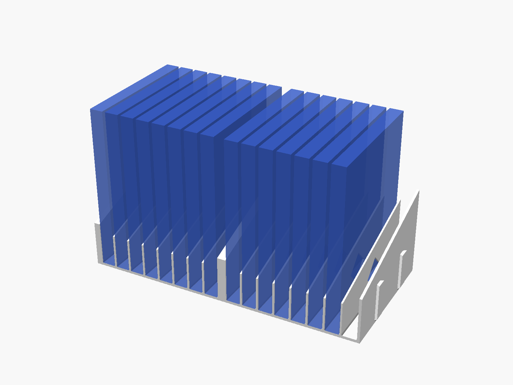
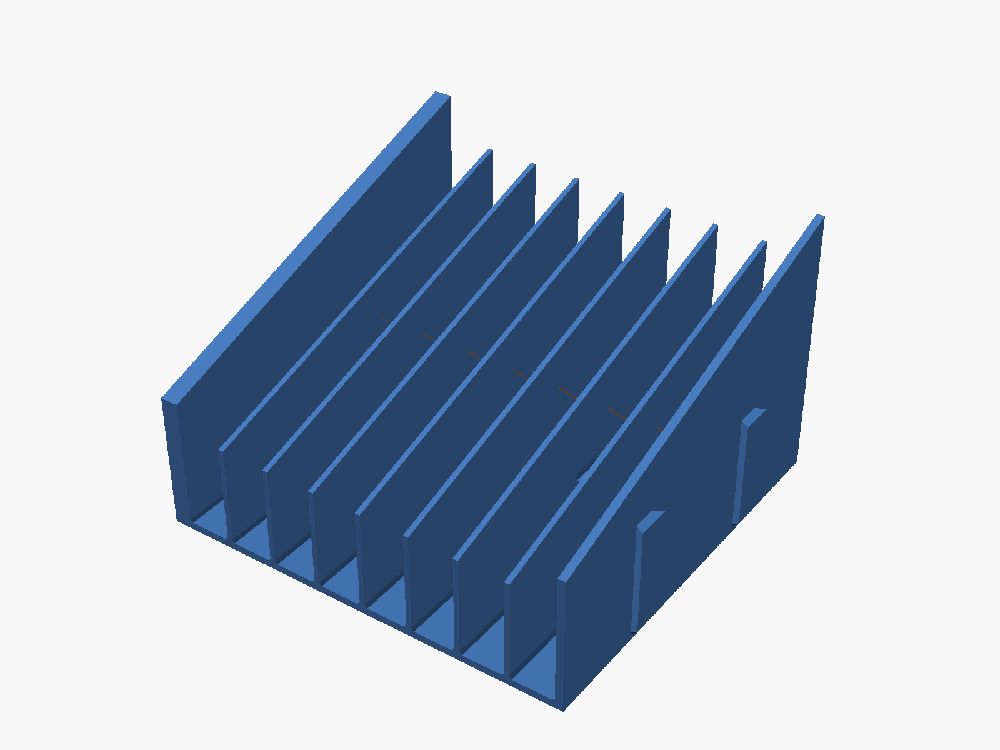
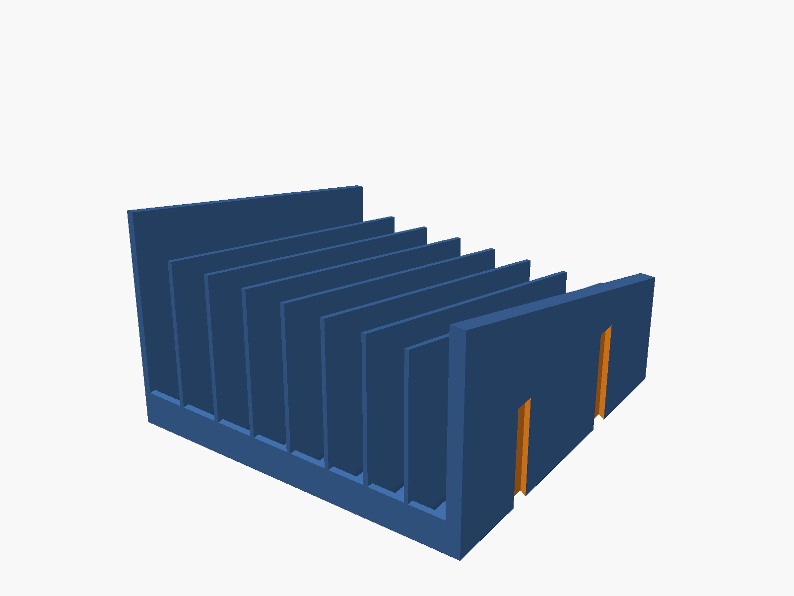

# PS5 Game Case Rack

A modular, spine-out shelf rack for PlayStation 5 game cases. Each module holds
**8 cases** standing upright like books, with the spines facing you. Identical
modules slide together on two vertical dovetails, so **two modules hold 16** —
enough for a 10–15 game collection with room to grow.

| Module, front | Module, back (dovetail slots in the left wall) |
|---|---|
|  |  |

## Files

| File | What it is |
|---|---|
| `ps5-case-rack-P1S.3mf` | **Open this first** in Bambu Studio / OrcaSlicer: one module, print settings applied |
| `ps5-case-rack-rack_module.stl` | Plain mesh for any other slicer |
| `ps5-case-rack.scad` | Parametric OpenSCAD source (case size, slot count, heights, joint fit) |

## Printing

- **Printer:** Bambu Lab P1S / X1C / A1 (256 mm bed). Each module is 149 × 140 × 93 mm,
  inside the X1/P1 front-left cutter exclusion. On an A1, switch the printer in Bambu Studio.
- **Material:** PLA (PETG also fine — set `dt_tol = 0.3`)
- **Settings:** 0.2 mm layers, 3 walls, 15% gyroid, **no supports**, base flat on the plate.
- **How many:** print the module twice for 16 cases.

## Joining modules

Lift the right-hand module about 45 mm above the left one's two rails. Line up the
slots in its left wall over the rails, then lower it straight down until both
modules sit on the table. If the fit is tight, a few strokes of sandpaper on the
rails will fix it.

## Things to check

- The slots assume a standard PS5 case: 14 mm thick, 135 mm deep, 171 mm tall, with
  0.75 mm of play each side. If your cases are tight, raise `slot_clear` in the `.scad`.
- Dovetail fit (0.2 mm clearance) is printer-dependent. Only a real print confirms it.

## Design history

| Version | AI model | Date | Change |
|---|---|---|---|
| v1 | claude-opus-5-5 (review: claude-sonnet-5-5) | 2026-11-22 | Initial design: 8-slot module, two dovetail joints, chamfered first layer |
